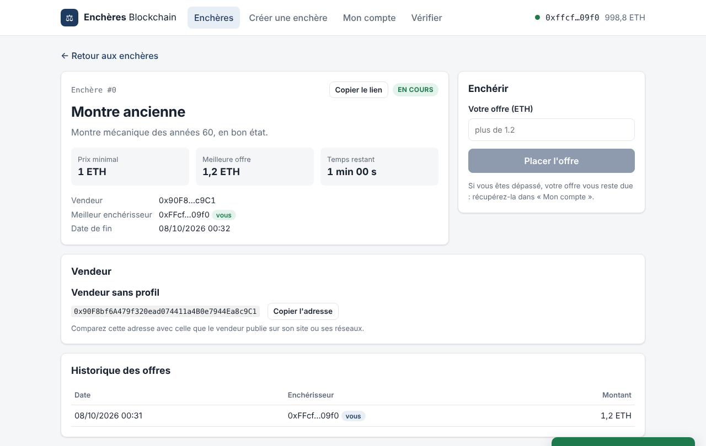
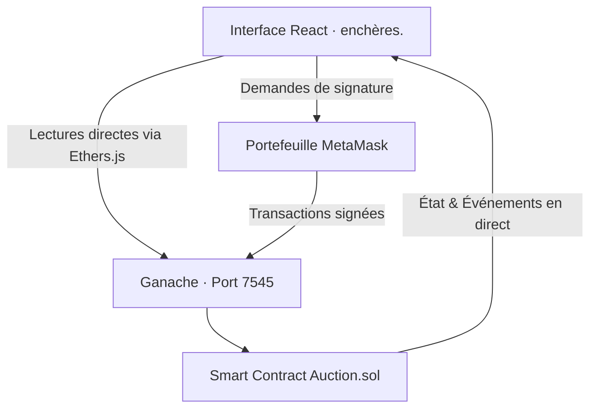

<p align="center">
  
</p>

<p align="center">
  <strong>Application décentralisée (DApp) de gestion d'enchères sur Ethereum</strong><br>
  <em>Découvrez des objets singuliers, proposez vos offres et vérifiez les annonces. Des enchères transparentes, décentralisées et sécurisées par smart contract, directement connectées à votre portefeuille MetaMask.</em>
</p>

<p align="center">
  
</p>

---

## Sommaire

- [1. À propos](#1-à-propos)
- [2. Fonctionnalités et conformité CDC](#2-fonctionnalités-et-conformité-cdc)
- [3. Architecture](#3-architecture)
- [4. Technologies utilisées](#4-technologies-utilisées)
- [5. Installation et démarrage](#5-installation-et-démarrage)
- [6. Configuration de MetaMask](#6-configuration-de-metamask)
- [7. Parcours utilisateur et navigation](#7-parcours-utilisateur-et-navigation)
- [8. Tests et commandes](#8-tests-et-commandes)
- [9. Organisation du code](#9-organisation-du-code)
- [10. Sécurité et conception](#10-sécurité-et-conception)
- [11. Dépannage](#11-dépannage)
- [12. Équipe projet](#12-équipe-projet)

---

## 1. À propos

Sur les plateformes d'enchères traditionnelles (eBay, Drouot...), la confiance repose sur un intermédiaire centralisé qui encaisse les fonds, décide unilatéralement de la fin des enchères et prélève des commissions importantes.

**enchères.** remplace cet intermédiaire par un **smart contract Solidity (`Auction.sol`) autonome et vérifiable sur Ethereum** :
- **Un vendeur** publie un objet avec un prix minimal et une durée fixe déterminée à l'avance.
- **Les enchérisseurs** soumettent leurs offres en ETH. Chaque nouvelle offre valide dépasse strictement la précédente et devient la meilleure offre provisoire.
- **Remboursement garanti (*Pull over Push*) :** les fonds des enchérisseurs dépassés sont crédités instantanément dans le contrat et peuvent être retirés à tout moment en toute sécurité.
- **Clôture mathématique :** dès l'échéance temporelle dépassée, n'importe quel participant peut clôturer l'enchère pour transférer les fonds au vendeur et désigner le gagnant.
- **Confiance & intégrité :** chaque article peut être associé à une photo dont l'empreinte **SHA-256** est scellée on-chain, et les annonces peuvent être signées cryptographiquement par le vendeur (EIP-191).

### Comparatif : Enchères traditionnelles vs *enchères.*

| Critère | Enchères traditionnelles (centralisées) | **enchères.** (DApp Ethereum) |
| :--- | :--- | :--- |
| **Qui garde l'argent ?** | Un compte bancaire privé intermédiaire | Le smart contract autonome (`Auction.sol`) |
| **Règles & temporalité** | Modifiables à tout moment par l'administrateur | Code Solidity immuable et temps scellé par la blockchain |
| **Remboursements** | Dépendent de la politique du site et des délais bancaires | Immédiats et garantis par le code (*retrait à la demande*) |
| **Attribution du lot** | Décision opaque de la plateforme | Déterminée mathématiquement par `highestBidder` à l'échéance |
| **Intégrité de la photo** | Image modifiable sur le serveur du site | Empreinte SHA-256 infalsifiable ancrée on-chain |
| **Authenticité du vendeur** | Profil fermé sur le site web | Clé publique Ethereum + annonce signée avec MetaMask |

---

## 2. Fonctionnalités et conformité CDC

L'application couvre l'intégralité des fonctionnalités obligatoires du **Cahier des Charges (Sujet 5)** ainsi que des fonctionnalités avancées de confiance :

| Réf. CDC | Fonctionnalité | Description dans le site **enchères.** | Implémentation technique |
| :---: | :--- | :--- | :--- |
| **F1** | **Création d'enchère** | Onglet **« Vendre un objet »** : nom, description, prix minimal, durée et prévisualisation. | `Auction.createAuction()` |
| **F2** | **Dépôt d'offres** | Saisie en ETH, raccourcis de surenchère et validation MetaMask. | `Auction.bid()` *(payable)* |
| **F3** | **Suivi en temps réel** | Meilleure offre, meilleur enchérisseur, décompte du temps et historique des offres. | `getAuction()` + écoute `BidPlaced` |
| **F4** | **Clôture** | Déclenchement public après échéance : paiement du vendeur et sacre du gagnant. | `Auction.endAuction()` |
| **F5** | **Remboursement** | Onglet **« Mon compte »** : retrait sécurisé à la demande des offres dépassées. | `Auction.withdraw()` |
| **F6** | **Traçabilité** | Émission d'événements Solidity (`AuctionCreated`, `BidPlaced`, `AuctionEnded`...). | Événements Solidity |
| **F7** | **Interface Web3** | Interface React avec intégration Ethers.js v6 et gestion des portefeuilles MetaMask. | React 18 + Ethers.js 6 |
| **F8** *(Bonus)* | **Photo infalsifiable** | Détection immédiate si la photo affichée a été modifiée par rapport au hash d'origine. | Hash SHA-256 on-chain (`imageHash`) |
| **F9** *(Bonus)* | **Annonces signées** | Signature d'annonce par le vendeur et vérification d'authenticité dans **« Vérifier une annonce »**. | Signatures EIP-191 via MetaMask |

### Règles de gestion strictes
1. Le prix minimal et la durée sont strictement supérieurs à zéro.
2. La première offre doit être $\ge$ au prix minimal ; les suivantes doivent strictement dépasser la meilleure offre (`msg.value > highestBid`).
3. Le vendeur ne peut jamais enchérir sur son propre article.
4. Aucune offre n'est acceptée après l'échéance ou après la clôture.
5. Une offre dépassée est immédiatement créditée dans `pendingReturns[address]` et reste retirable par son auteur.
6. La clôture est irréversible et ne peut être exécutée qu'une seule fois par enchère.
7. Une enchère sans offre se termine sans gagnant ni transfert de fonds.
8. Si le paiement direct au vendeur échoue, le montant lui est conservé dans le contrat pour un retrait ultérieur (anti-blocage).

---

## 3. Architecture

L'application fonctionne selon une architecture 100% décentralisée sans backend centralisé :



---

## 4. Technologies utilisées

| Composant | Technologie | Rôle |
| :--- | :--- | :--- |
| **Smart contract** | Solidity `^0.8.20` | Logique métier décentralisée et gestion des fonds |
| **Sécurité** | OpenZeppelin (`ReentrancyGuard`) | Protection contre les attaques par réentrance |
| **Développement Web3** | Truffle Suite `v5.x` | Compilation, migrations et suite de tests Mocha/Chai |
| **Blockchain locale** | Ganache 7 (`port 7545`, `chain ID 1337`) | Environnement Ethereum de développement déterministe |
| **Interface Web** | React 18, Vite 5, CSS moderne | Application Web réactive avec polices Manrope et animations accessibles |
| **Intégration Web3** | Ethers.js `v6` | Interaction avec la blockchain, RPC et écoute d'événements |
| **Portefeuille** | MetaMask | Signature des transactions et messages EIP-191 |
| **Intégrité média** | SHA-256 client & on-chain | Preuve d'authenticité de la photo de l'article |

---

## 5. Installation et démarrage

### Prérequis
- [Git](https://git-scm.com/)
- [Node.js](https://nodejs.org/) (testé sous Node 22) et `npm`
- Extension [MetaMask](https://metamask.io/) dans votre navigateur

### 1. Cloner et installer
```bash
git clone https://github.com/oussemazghal/blockchain-project.git
cd blockchain-project

# Installe les dépendances du contrat et de l'interface React
npm run setup
```

### 2. Démarrer l'environnement local (3 terminaux)

Ouvrir **trois terminaux séparés** à la racine du projet :

#### 🔹 Terminal 1 — Blockchain locale Ganache
```bash
npm run ganache
```
*Démarre la blockchain locale sur `http://127.0.0.1:7545` (Chain ID : `1337`) avec 10 comptes préfinancés à 1000 ETH de test.*

#### 🔹 Terminal 2 — Déploiement du Smart Contract
```bash
npm run migrate
```
*Compile `Auction.sol`, le déploie sur Ganache et synchronise automatiquement l'ABI et l'adresse avec le frontend.*

#### 🔹 Terminal 3 — Interface Web **enchères.**
```bash
npm run frontend
```
*Lance le serveur de développement Vite. Ouvrez votre navigateur sur **`http://localhost:5173`**.*

---

## 6. Configuration de MetaMask

1. **Ajouter le réseau Ganache Local :**
   - **Nom du réseau :** `Ganache Local`
   - **URL RPC :** `http://127.0.0.1:7545`
   - **ID de chaîne :** `1337`
   - **Symbole :** `ETH`

2. **Importer des comptes de test :**  
   Depuis MetaMask, choisissez *Importer un compte* et collez l'une des clés privées affichées dans votre terminal Ganache (un vendeur et deux enchérisseurs).

> ⚠️ *Les clés Ganache sont publiques et réservées exclusivement aux tests locaux. Ne les utilisez jamais sur un réseau réel.*

---

## 7. Parcours utilisateur et navigation

L'application **enchères.** est organisée autour de 4 onglets principaux :

1. **Explorer :**
   - Catalogue complet des articles mis aux enchères.
   - Recherche textuelle, filtres par statut (Toutes, En cours, Bientôt terminées, Clôturées), tri par prix ou date, et bascule d'affichage grille/liste.
2. **Vendre un objet :**
   - Formulaire de création : intitulé, description, prix minimal en ETH, durée de l'enchère.
   - Ajout d'une photo avec calcul automatique de l'empreinte SHA-256 et prévisualisation avant mise en vente.
3. **Fiche article & Enchères :**
   - Décompte du temps en direct, indicateur du meilleur enchérisseur et historique complet des offres.
   - Formulaire de surenchère avec raccourcis rapides (+0.1 ETH, +0.5 ETH, +1 ETH).
   - Bouton de clôture apparaissant automatiquement après expiration de l'échéance.
   - Génération d'une annonce signée cryptographiquement avec MetaMask.
4. **Vérifier une annonce :**
   - Outil de vérification public permettant de coller une annonce signée pour valider qu'elle émane bien du vendeur enregistré on-chain et n'a pas été altérée.
   - Vérification de l'intégrité de la photo par comparaison de hash.
5. **Mon compte :**
   - Suivi de l'adresse connectée, du solde en ETH et du réseau actif.
   - Solde bloqué retirable (*Pull payment*) et bouton « Retirer mes fonds ».
   - Édition du profil vendeur public (nom et lien externe) enregistré dans la blockchain.
   - Déconnexion et changement rapide de compte MetaMask.

---

## 8. Tests et commandes

Le projet intègre une suite complète de **31 tests Truffle** validant la conformité métier, les rejets d'erreurs et la résistance aux attaques de sécurité.

```bash
# 31 tests Truffle du Smart Contract (en mémoire)
npm test

# Tests Truffle sur le serveur Ganache actif
npm run test:ganache

# Tests unitaires du catalogue frontend (recherche, filtres, tri)
npm --prefix frontend test

# Tests de rendu de l'interface utilisateur
npm --prefix frontend run test:render
```

### Commandes npm principales

| Commande | Action |
| :--- | :--- |
| `npm run setup` | Installe toutes les dépendances du projet (racine et frontend). |
| `npm run compile` | Compile les smart contracts Solidity avec Truffle. |
| `npm run ganache` | Démarre la blockchain locale sur le port 7545. |
| `npm run migrate` | Déploie `Auction.sol` et synchronise l'ABI frontend. |
| `npm run frontend` | Démarre l'interface Web Vite sur `http://localhost:5173`. |
| `npm test` | Exécute les 31 tests Truffle automatisés. |
| `npm --prefix frontend run build` | Compile le frontend React pour la production. |

---

## 9. Organisation du code

```
blockchain-project/
├── contracts/
│   ├── Auction.sol                 # Smart contract principal des enchères
│   └── test/                       # Contrats de simulation pour les tests de sécurité
│       ├── ReentrancyAttacker.sol  # Simulation d'attaque par réentrance
│       └── RejectingSeller.sol     # Vendeur rejetant les transferts (test anti-DoS)
├── migrations/
│   └── 1_deploy_auction.js         # Déploiement Truffle et export automatique de l'ABI
├── test/
│   └── auction.test.js             # 31 tests Truffle couvrant l'ensemble des règles
├── frontend/                       # Application Web React + Vite (enchères.)
│   ├── src/
│   │   ├── components/             # Composants (Header, AuctionList, AuctionDetail, CreateAuction...)
│   │   ├── hooks/                  # useWallet (MetaMask), useAuctions, useProfile, useScrollReveal
│   │   ├── lib/                    # blockchain.js (Ethers), trust.js (SHA-256), catalog.js
│   │   ├── contract/Auction.json   # ABI et adresse déployée synchronisées
│   │   ├── styles.css              # Styles principaux et identité visuelle
│   │   └── motion.css              # Animations légères et accessibles
│   └── public/                     # Polices Manrope locales et visuels éditoriaux
├── truffle-config.js               # Configuration du compilateur et des réseaux
└── README.md                       # Documentation officielle
```

---

## 10. Sécurité et conception

- **Modèle Pull over Push :** le smart contract ne renvoie jamais directement les fonds lors d'une surenchère dans `bid()`. Les fonds sont placés en attente dans `pendingReturns`. Ce mécanisme préserve l'application contre les attaques par déni de service (DoS).
- **Verrou anti-réentrance :** les fonctions de retrait et clôture appliquent le principe *Checks-Effects-Interactions* et utilisent le modificateur `nonReentrant` d'OpenZeppelin.
- **Synchronisation Ganache :** pour éviter qu'une simulation MetaMask n'utilise un horodatage figé sur Ganache, un bloc vide est miné automatiquement avant les transactions sensibles (`syncLocalChainTime`).

---

## 11. Dépannage

| Symptôme | Cause | Solution |
| :--- | :--- | :--- |
| **Ganache injoignable** | Le processus Ganache est éteint | Vérifier que `npm run ganache` tourne bien dans le premier terminal. |
| **Contrat introuvable** | Ganache a été redémarré sans redéploiement | Lancer `npm run migrate` dans le Terminal 2 puis rafraîchir la page Web. |
| **Erreur de nonce dans MetaMask** | MetaMask a conservé l'historique d'une ancienne instance Ganache | Dans MetaMask : *Paramètres* $\rightarrow$ *Avancé* $\rightarrow$ **« Effacer les données d'activité »**. |
| **Solde à 0 ETH** | Mauvais réseau sélectionné | Vérifier que le réseau actif est bien `Ganache Local` (Chain ID `1337`). |

---

## 12. Équipe projet

Projet réalisé dans le cadre du module **Blockchain** — Sujet 5 : *Mise en vente d'un article avec enchère minimale et durée fixe*.

**Faculté des Sciences de Sfax (FSS) — Université de Sfax**  
*Année universitaire : 2026–2027*  
*Encadrant : M. Claude Duvallet*

| Membre | Profil GitHub | Responsabilités techniques |
| :--- | :--- | :--- |
| **Med Amine Salhi** | [@medaminesalhi](https://github.com/medaminesalhi) | Smart contract Solidity (`Auction.sol`), règles métier, sécurité, réentrance et événements. |
| **Oussema Zghal** | [@oussemazghal](https://github.com/oussemazghal) | Tests unitaires Truffle (31 tests), scripts de migration et gestion du réseau Ganache. |
| **Omar Bouattour** | [@OmarBouat](https://github.com/OmarBouat) | Interface React (**enchères.**), composants, navigation, formulaires et design visuel. |
| **Nour Mellah** | [@nourmellah](https://github.com/nourmellah) | Intégration Web3, Ethers.js v6, connexion MetaMask, exécution des transactions et événements. |

*La conception architecturale, la relecture croisée du code, les tests d'intégration, le rapport technique et la vidéo de démonstration ont été réalisés conjointement par l'ensemble de l'équipe.*
