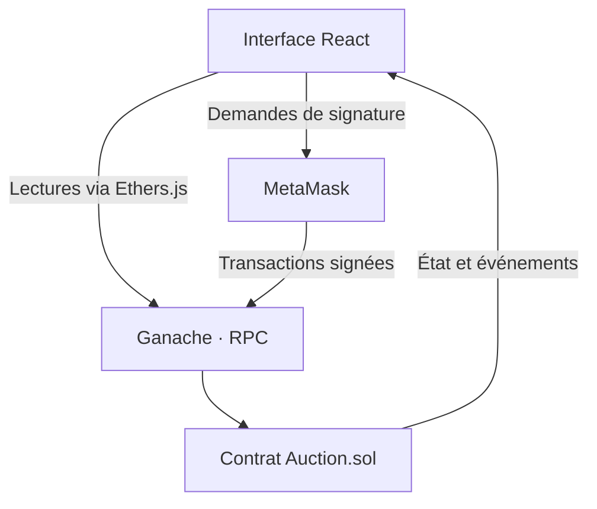

# Enchères DApp

Application décentralisée de gestion d’enchères sur Ethereum, développée avec **Solidity, React et Ethers.js**. Un vendeur publie un article avec un prix minimal et une durée fixe ; les participants déposent leurs offres via MetaMask et le smart contract applique les règles de l’enchère.

Le projet fonctionne sur **Ganache**, avec des ETH de test. Il comprend la gestion des offres, la clôture, le retrait des fonds, la vérification des photos par empreinte SHA-256 et les annonces signées.

## Sommaire

- [Fonctionnalités](#fonctionnalités)
- [Architecture](#architecture)
- [Technologies](#technologies)
- [Installation](#installation)
- [Configuration du portefeuille](#configuration-du-portefeuille)
- [Parcours utilisateur](#parcours-utilisateur)
- [Tests et commandes](#tests-et-commandes)
- [Organisation du code](#organisation-du-code)
- [Sécurité et limites](#sécurité-et-limites)
- [Dépannage](#dépannage)
- [Équipe](#équipe)

## Fonctionnalités

| Fonctionnalité | Description |
| --- | --- |
| Création d’enchères | Nom, description, photo facultative, prix minimal et durée, avec aperçu de l’annonce. |
| Catalogue | Recherche, filtres par état, compteurs, tri et présentation en grille ou en liste. |
| Dépôt d’offres | Saisie en ETH, raccourcis de montant et confirmation dans MetaMask. |
| Suivi | Meilleure offre, meilleur enchérisseur, compte à rebours et historique des offres. |
| Clôture | Désignation du gagnant et paiement du vendeur après l’échéance. |
| Retrait des fonds | Récupération à la demande des montants des offres dépassées. |
| Portefeuille | Consultation du compte, du solde et du réseau ; changement de compte et déconnexion. |
| Confiance | Vérification de l’intégrité des photos, profil public du vendeur et annonces signées. |
| Partage | Lien direct vers une enchère et copie des adresses et empreintes. |

### Règles de gestion

1. Le prix minimal et la durée sont strictement positifs.
2. La première offre est au moins égale au prix minimal ; les suivantes dépassent strictement la meilleure offre.
3. Le vendeur ne peut pas enchérir sur sa propre vente.
4. Aucune offre n’est acceptée après l’échéance ou après la clôture.
5. Une offre dépassée est créditée dans `pendingReturns` et peut être retirée par son auteur.
6. La clôture est accessible après l’échéance et ne peut être exécutée qu’une seule fois par enchère.
7. Une enchère sans offre se termine sans gagnant ni transfert de fonds.
8. Si le paiement direct au vendeur échoue, le montant lui est crédité pour un retrait ultérieur.

## Architecture

La logique métier et les soldes remboursables sont gérés par `Auction.sol`. L’interface lit l’état du contrat via RPC et utilise MetaMask pour faire signer les transactions. Les événements permettent d’actualiser les données et de reconstituer l’historique des offres.



Les signatures d’annonces sont distinctes des transactions : signer un message ne modifie pas l’état de la blockchain et ne consomme pas de gas.

## Technologies

| Composant | Technologie |
| --- | --- |
| Smart contract | Solidity `^0.8.20` |
| Protection contre la réentrance | OpenZeppelin Contracts |
| Compilation, migrations et tests | Truffle 5, Mocha et Chai |
| Blockchain locale | Ganache 7 |
| Interface | React 18, Vite et CSS |
| Intégration Ethereum | Ethers.js 6 |
| Portefeuille | MetaMask |
| Intégrité des images | SHA-256 |
| Signature des annonces | EIP-191 |

## Installation

### Prérequis

- Git.
- Node.js et npm ; l’environnement du projet est indiqué comme testé sous Node.js 22.
- MetaMask pour les opérations nécessitant une signature.

### Cloner et installer

```bash
git clone https://github.com/oussemazghal/blockchain-project.git
cd blockchain-project
npm run setup
```

### Démarrer l’environnement local

Exécuter les commandes suivantes depuis la racine du projet, dans **trois terminaux séparés**.

**Terminal 1 — Blockchain locale**

```bash
npm run ganache
```

Conserver ce processus actif. L’interface et le déploiement utilisent son endpoint RPC.

**Terminal 2 — Déploiement du contrat**

```bash
npm run migrate
```

La migration déploie le contrat et synchronise l’ABI et les informations de déploiement avec le frontend.

**Terminal 3 — Interface Web**

```bash
npm run frontend
```

Ouvrir l’adresse affichée par Vite, généralement `http://localhost:5173`.

## Configuration du portefeuille

Ajouter le réseau local dans MetaMask :

| Paramètre | Valeur |
| --- | --- |
| Nom du réseau | `Ganache Local` |
| URL RPC | `http://127.0.0.1:7545` |
| Chain ID | `1337` |
| Symbole | `ETH` |

Importer trois comptes à partir des clés de test affichées par **l’instance Ganache en cours d’exécution** : un vendeur et deux enchérisseurs. Leurs adresses et soldes dépendent de la configuration locale.

> Les comptes et clés Ganache sont réservés au développement. Ne pas les utiliser pour détenir des fonds réels.

Cliquer sur l’adresse affichée dans l’application pour consulter le portefeuille, changer de compte ou se déconnecter. Attendre la confirmation d’une transaction avant de changer de participant.

## Parcours utilisateur

1. **Créer une enchère.** Avec le compte vendeur, ouvrir « Vendre un objet », renseigner l’article, choisir une photo et définir les conditions. Vérifier l’aperçu, puis confirmer la transaction.
2. **Déposer une offre.** Avec un autre compte, ouvrir l’article depuis « Explorer », saisir un montant valide et confirmer dans MetaMask.
3. **Surenchérir.** Utiliser un second enchérisseur pour proposer un montant supérieur. L’historique et la meilleure offre sont actualisés.
4. **Retirer les fonds.** Revenir au compte dépassé et utiliser « Mon compte » pour demander le retrait de son solde remboursable.
5. **Clôturer.** Une fois le délai écoulé, déclencher la clôture et confirmer la transaction. La fiche affiche le gagnant et le résultat final.
6. **Vérifier les informations.** Consulter le statut de la photo et utiliser « Vérifier une annonce » pour contrôler une annonce signée.

Exemple de scénario : article « Radio », prix minimal de **4 ETH**, durée de **2 minutes**, première offre de **5 ETH**, puis surenchère de **7 ETH**.

## Tests et commandes

La suite du contrat comprend **31 tests** portant notamment sur la création, les offres, les remboursements, la clôture et les protections de sécurité. Le résultat d’une exécution doit être vérifié dans la sortie du terminal ; un nombre de tests réussis ne constitue pas une mesure de couverture du code.

```bash
# Tests du contrat sur une instance Ganache en mémoire
npm test

# Tests du catalogue : recherche, filtres et tri
npm --prefix frontend test

# Tests de rendu des pages et états de l’interface
npm --prefix frontend run test:render
```

| Commande | Utilité |
| --- | --- |
| `npm run setup` | Installer les dépendances du projet et du frontend. |
| `npm run compile` | Compiler les smart contracts. |
| `npm run ganache` | Démarrer la blockchain locale. |
| `npm run migrate` | Déployer le contrat et synchroniser le frontend. |
| `npm run frontend` | Démarrer le serveur Vite. |
| `npm test` | Exécuter les tests Truffle en mémoire. |
| `npm run test:ganache` | Exécuter les tests sur le Ganache actif. |
| `npm --prefix frontend test` | Tester les fonctions du catalogue. |
| `npm --prefix frontend run test:render` | Tester le rendu de l’interface. |

Privilégier les tests en mémoire pendant une session de démonstration : certains tests avancent l’horloge de la blockchain et peuvent modifier le contexte d’un réseau partagé.

## Organisation du code

| Chemin | Responsabilité |
| --- | --- |
| `contracts/Auction.sol` | Données, règles métier, transferts et événements. |
| `contracts/test/` | Contrats auxiliaires pour les scénarios de sécurité. |
| `migrations/1_deploy_auction.js` | Déploiement et export des informations du contrat. |
| `test/auction.test.js` | Suite de tests du smart contract. |
| `frontend/src/components/` | Pages et composants de l’interface. |
| `frontend/src/hooks/` | Gestion du portefeuille, des enchères et des profils. |
| `frontend/src/lib/blockchain.js` | Accès Ethereum, formats et gestion des erreurs. |
| `frontend/src/lib/trust.js` | Empreintes et signatures d’annonces. |
| `frontend/src/contract/Auction.json` | Artefact du contrat utilisé par le frontend. |
| `truffle-config.js` | Compilateur et configuration réseau. |
| `package.json` | Dépendances et scripts npm. |

## Sécurité et limites

### Retrait à la demande

Lors d’une surenchère, le contrat crédite `pendingReturns` au lieu de rembourser immédiatement l’ancien enchérisseur. Ce modèle évite qu’un destinataire refusant les ETH bloque les nouvelles offres. Le retrait remet le solde à zéro avant le transfert et utilise une protection contre la réentrance.

### Intégrité des photos et signatures

Le contrat conserve une référence d’image et son empreinte SHA-256. La comparaison des empreintes permet de détecter une modification du fichier ; elle **ne prouve pas l’authenticité de l’objet photographié**. La disponibilité de l’image dépend également de son stockage et de son accessibilité.

Une annonce signée permet de vérifier qu’un message a été signé par l’adresse du vendeur et n’a pas été modifié. Elle ne certifie pas, à elle seule, l’identité civile ou l’honnêteté du vendeur.

### Clôture et environnement de test

- La clôture nécessite une transaction après l’échéance : le contrat ne s’exécute pas spontanément.
- Le contrat gère les fonds, mais ne garantit pas la livraison d’un objet physique.
- Les offres sont publiques ; le mécanisme ne masque pas les montants déposés.
- Sur Ganache, la simulation d’une transaction peut utiliser un dernier bloc antérieur à l’échéance. La synchronisation locale peut demander un bloc vide avec `evm_mine` ; cette méthode est réservée au développement.
- Ce projet pédagogique ne constitue pas un système audité pour une utilisation avec des fonds réels.

## Dépannage

| Symptôme | Vérification et action |
| --- | --- |
| Ganache injoignable | Vérifier que `npm run ganache` reste actif et écoute sur le port `7545`. |
| Contrat introuvable | Vérifier le réseau, puis relancer `npm run migrate` si la chaîne a été réinitialisée. Actualiser l’application. |
| Solde nul | Vérifier le Chain ID `1337` et importer un compte de l’instance Ganache active. |
| Erreur de nonce après réinitialisation | Vérifier que le compte et le réseau correspondent à la chaîne active ; réinitialiser si nécessaire l’historique d’activité du compte de test dans MetaMask. |
| Offre refusée | Vérifier le prix minimal, la meilleure offre, l’échéance et l’adresse du vendeur. |
| Clôture refusée malgré le compte à rebours | Vérifier l’horodatage du dernier bloc et la synchronisation de l’horloge locale. |

## Équipe

Projet réalisé dans le cadre du module **Blockchain**, sujet 5 : *Mise en vente d’un article avec enchère minimale et durée fixe*.

**Faculté des Sciences de Sfax — Université de Sfax**  
**Année universitaire : 2026–2027**  
**Encadrant : M. Claude Duvallet**

| Membre | Responsabilité principale |
| --- | --- |
| [Med Amine Salhi](https://github.com/medaminesalhi) | Smart contract Solidity, règles métier, retraits, sécurité et événements. |
| [Oussema Zghal](https://github.com/oussemazghal) | Tests Truffle, migrations et configuration Ganache. |
| [Omar Bouattour](https://github.com/OmarBouat) | Interface React, formulaires, affichage et gestion des erreurs. |
| [Nour Mellah](https://github.com/nourmellah) | Intégration Ethers.js, MetaMask, transactions et événements. |

La conception, la relecture du code, les tests d’intégration, le rapport technique et la démonstration sont réalisés en collaboration.
